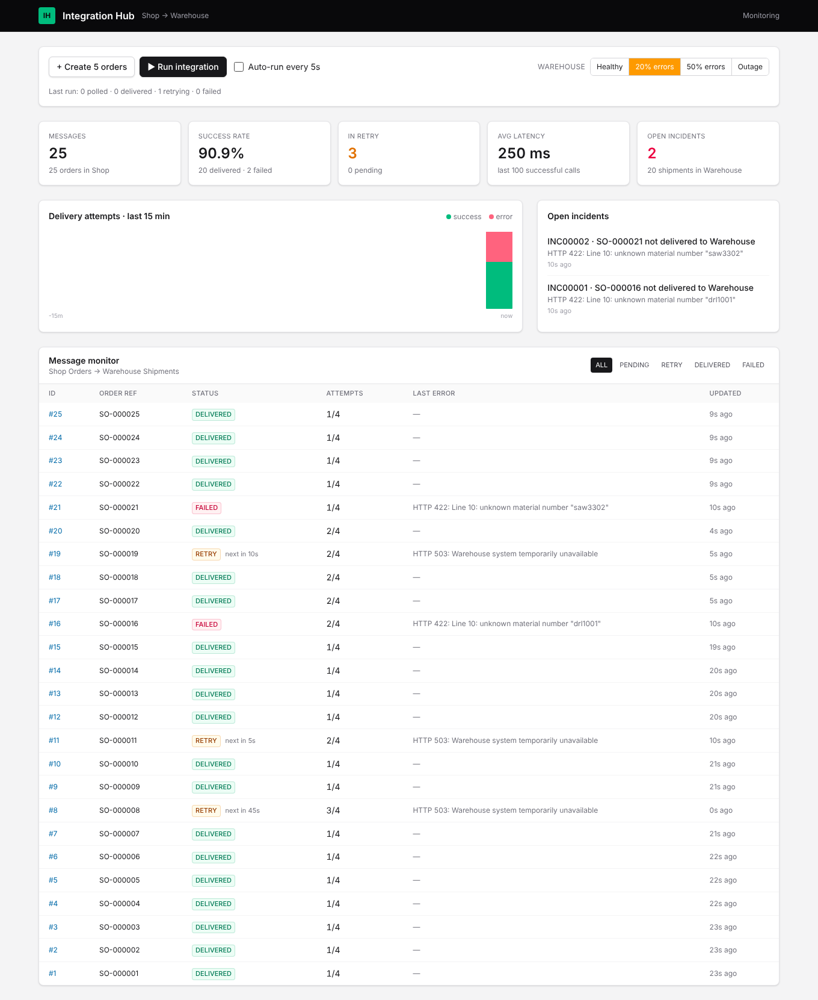
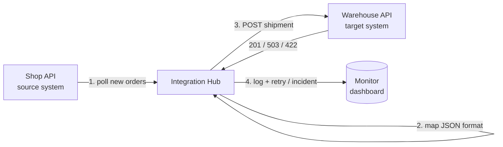

# Integration Hub

A small **system integration and monitoring platform**. It moves orders from a **Shop** system to a **Warehouse** system, transforms the data in between, retries when the target system is down, and opens an **incident** when a message can't be delivered. A live **monitoring dashboard** shows every message.

It's built to show how enterprise integration works, like what middleware such as **SAP Integration Suite / SAP PI/PO** does in a real company.



## What it does



| Situation | What the hub does |
|---|---|
| Warehouse answers **2xx** | Message → `DELIVERED` |
| **Timeout or 5xx** (temporary problem) | Message → `RETRY`, tries again after **5s, 15s, 45s** (exponential backoff) |
| Still failing after **4 attempts** | Message → `FAILED`, **incident opened** |
| **4xx** such as 422 bad data (permanent problem) | `FAILED` immediately, no pointless retries, incident opened |
| Operator clicks **Reprocess** | Message gets a fresh set of attempts; incident auto-resolves on success |
| Same shipment sent twice | Warehouse is **idempotent**: no duplicate is created |
| Incident opened / resolved | Synced to **ServiceNow** as a real incident ticket, and resolved there too |

You can break the Warehouse from the dashboard (**20% errors / 50% errors / Outage**) to watch retries and incidents happen live.

## Concepts, and their SAP equivalents

| This project | In SAP Integration Suite |
|---|---|
| Flow "Shop Orders → Warehouse Shipments" | Integration Flow (iFlow) |
| `lib/mapping.ts` | Message Mapping |
| Message monitor + delivery log | Monitor Message Processing |
| Correlation ID on every message | Message ID / Correlation ID |
| Retry with backoff | JMS retry / exception subprocess |
| Incidents synced to ServiceNow | Alerting → ServiceNow ticket |

## ServiceNow integration

When a message fails, the hub creates an incident in **ServiceNow** through the **Table API** (`POST /api/now/table/incident`). When the message is later reprocessed and delivered, the hub resolves the ServiceNow incident too (`PATCH`, state = Resolved).

It uses an **outbox pattern**: incidents are saved locally first, then synced. If ServiceNow is down or hibernating, nothing is lost. The sync retries on the next run, and the error is shown on the dashboard.

Each ServiceNow incident carries the message's **correlation ID**, so you can trace a ticket back to the exact message.

To connect your own instance (a free ServiceNow Personal Developer Instance works), copy `.env.example` to `.env.local` and fill in the values. Without them, the hub runs normally and keeps incidents locally.

## Tech stack

- **Next.js 16** (App Router, Server Actions, Route Handlers) + **TypeScript**
- **ServiceNow Table API** (REST, Basic auth) for incident management
- **SQLite** (Node's built-in `node:sqlite`, no setup needed)
- **Tailwind CSS**
- **Vitest**: unit and integration tests
- **GitHub Actions**: CI runs lint, tests and build on every push

## Run it locally

Requires Node.js 24 or newer.

```bash
npm install
npm run dev
```

Open http://localhost:3000, click **Create 5 orders**, then **Run integration**.

```bash
npm test        # run the tests
npm run lint    # check code style
```

## API

| Method | Endpoint | System |
|---|---|---|
| `GET` | `/api/shop/orders?after={id}` | Shop: list orders created after an ID |
| `POST` | `/api/shop/orders` `{"count": 5}` | Shop: create test orders |
| `POST` | `/api/warehouse/shipments` | Warehouse: receive a shipment request |

## Project structure

```
app/
  page.tsx                        Monitoring dashboard
  messages/[id]/page.tsx          Message detail: delivery log, payloads, reprocess
  api/shop/orders/route.ts        Shop API (source)
  api/warehouse/shipments/route.ts Warehouse API (target)
  actions.ts                      Server actions used by the dashboard
lib/
  integration.ts                  The hub engine: poll, map, deliver, retry, incidents
  mapping.ts                      Data formats, mapping and validation
  db.ts                           SQLite schema and helpers
  servicenow.ts                   ServiceNow connector (incident sync)
tests/                            Vitest tests
.github/workflows/ci.yml          CI pipeline
```

## Roadmap

- [x] Create real tickets in **ServiceNow** when an incident opens
- [ ] OAuth instead of Basic auth for ServiceNow
- [ ] **Docker** + Docker Compose
- [ ] PostgreSQL and a live deployed demo
- [ ] Scheduled polling with a cron job instead of the dashboard's auto-run
